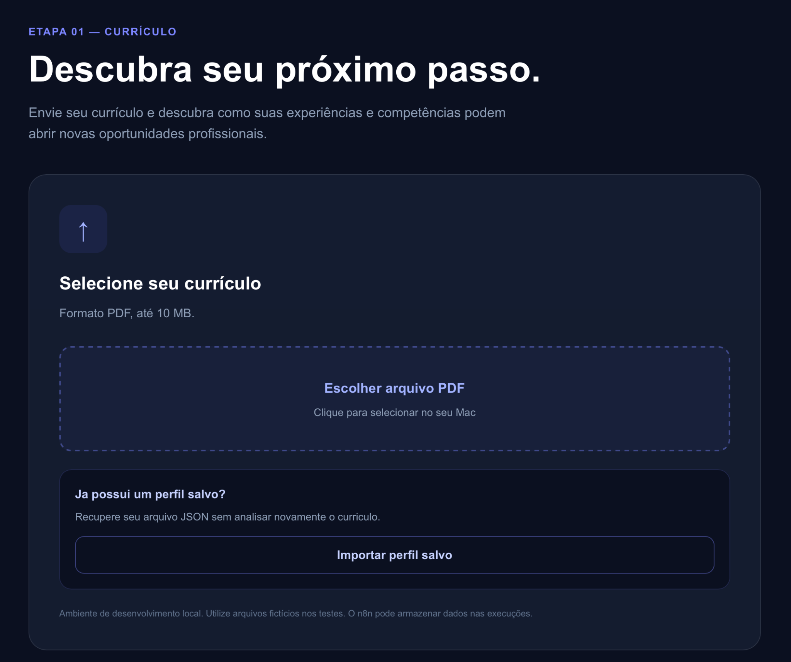
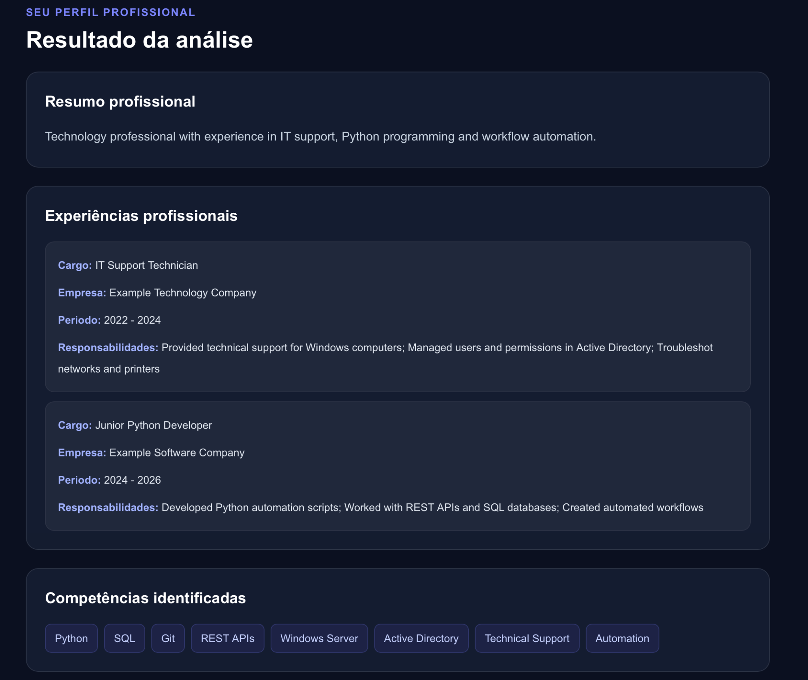
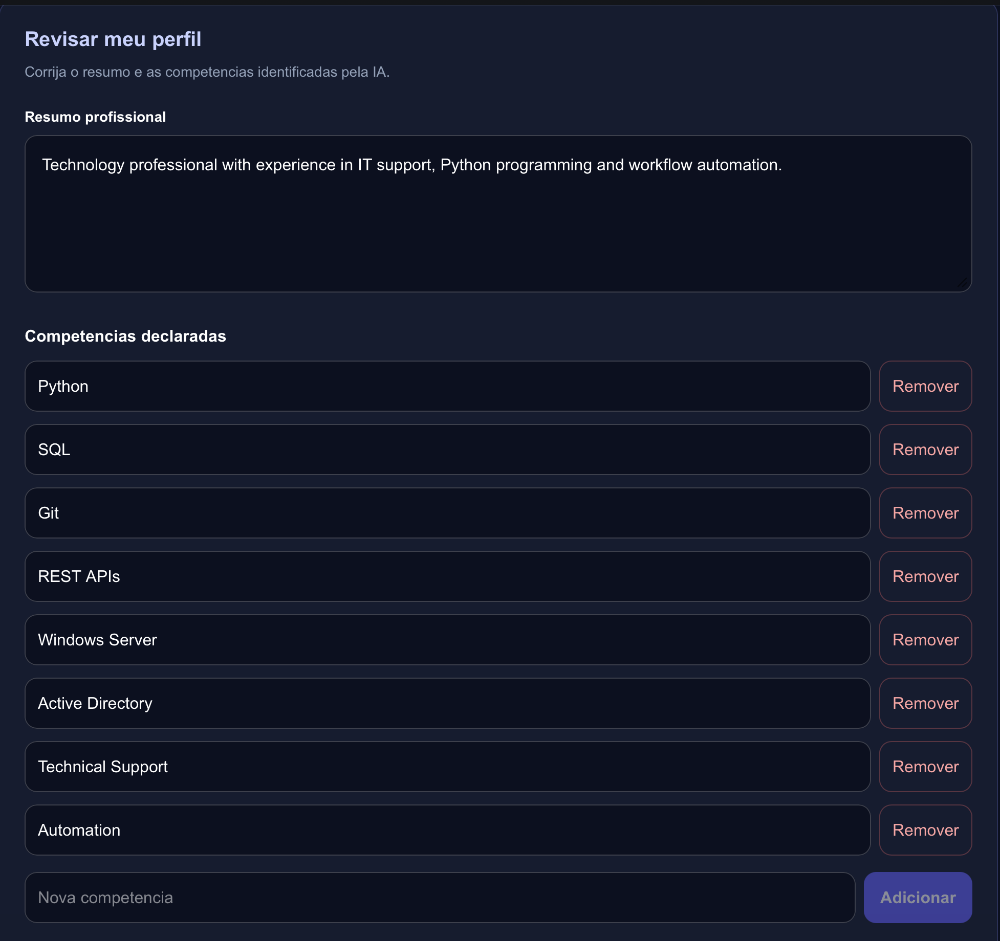
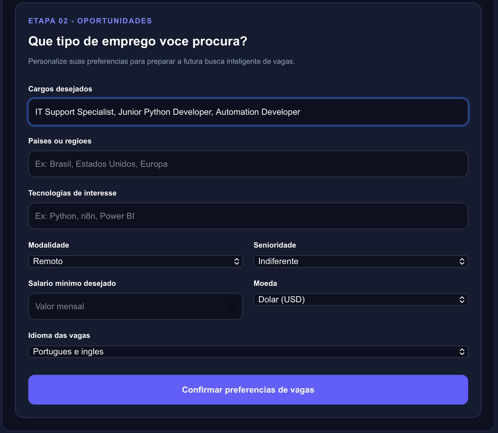
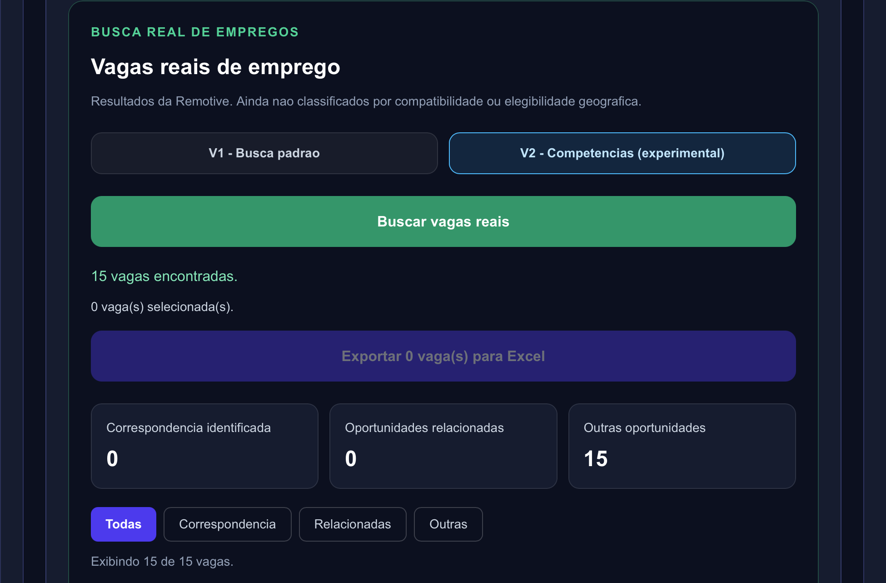
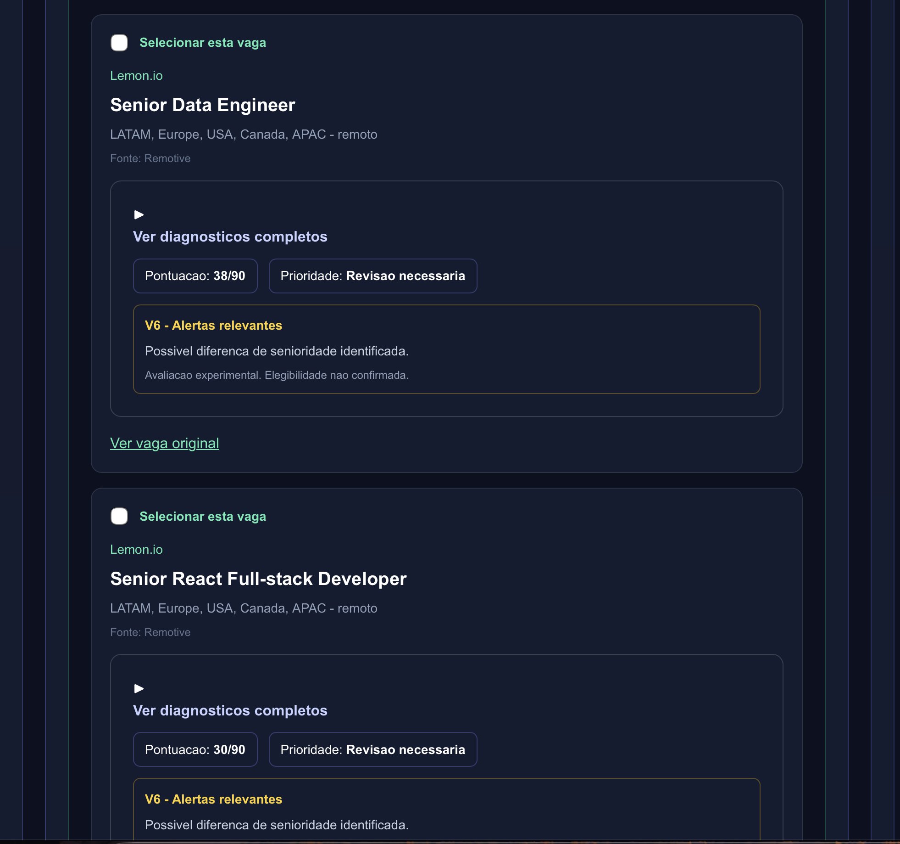
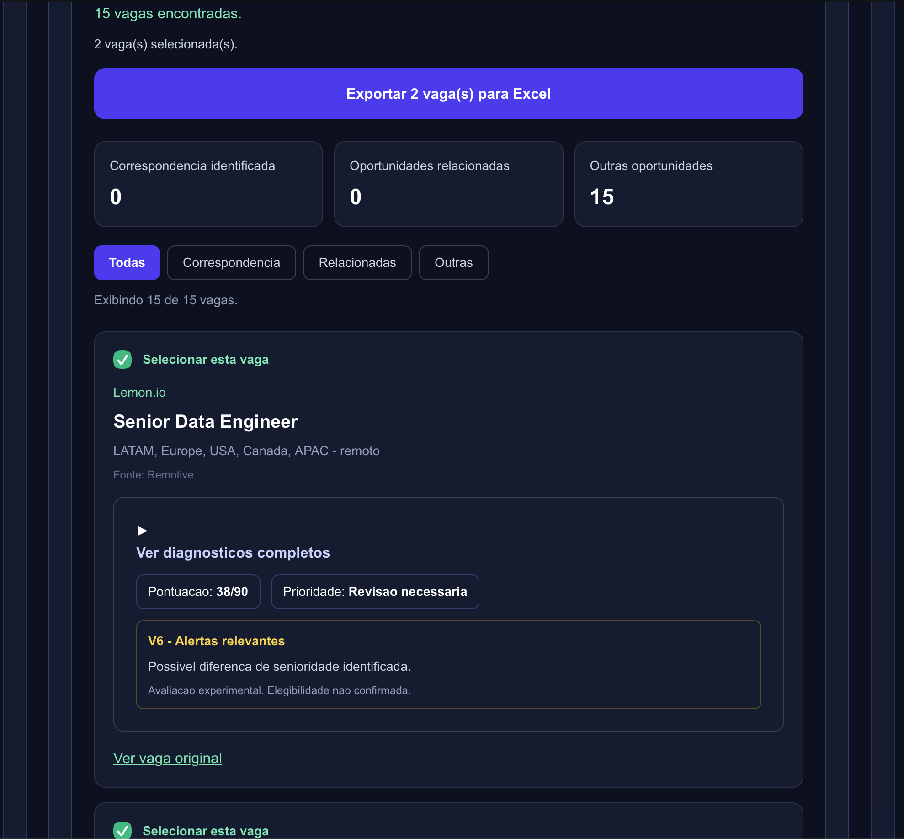
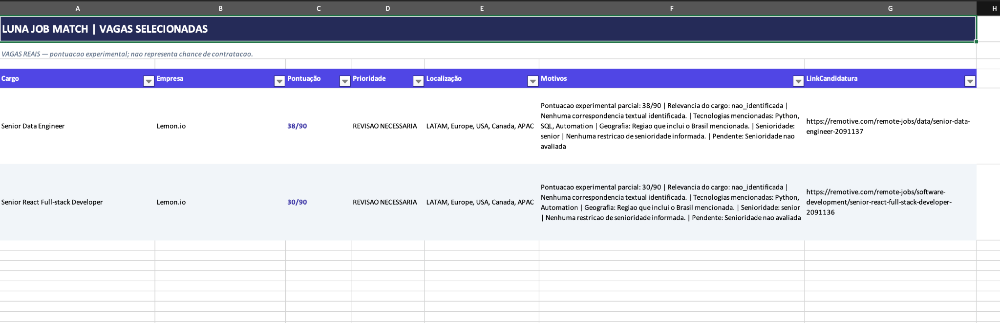

# LUNA Job Match

An experimental job-matching web application that
helps candidates analyze their professional profiles,
explore real job opportunities, review matching
indicators, and export selected positions.

**AI-assisted job matching | Explainable assessments | Automation**

**Tech stack:** Next.js 16 · React 19 · TypeScript · n8n · ExcelJS

**Status:** Local experimental prototype — not a production service.

## Quick Navigation

- [Application Screenshots](#application-screenshots)
- [Features](#features)
- [Technology Stack](#technology-stack)
- [Application Workflow](#application-workflow)
- [Architecture](#architecture)
- [Validation and Testing](#validation-and-testing)
- [Technical Decisions](#technical-decisions)
- [Current Limitations](#current-limitations)
- [Roadmap](#roadmap)

## Application Screenshots

The following screenshots show the local
end-to-end demonstration of LUNA Job Match.

The candidate profile is fictional.
Job listings were retrieved during a local
demonstration and may no longer be available.

| | |
|---|---|
| **Resume Upload** | **Resume Analysis** |
|  |  |
| **Profile Review** | **Job Preferences** |
|  |  |
| **Real Job Search** | **Explainable Matching** |
|  |  |
| **Job Selection** | **Excel Export** |
|  |  |

These images document a local prototype,
not a publicly deployed production service.

## Technical Documentation

The following documents provide additional engineering context:

- [Architecture](docs/ARCHITECTURE.md)
- [Security Validation](docs/SECURITY_VALIDATION.md)
- [Technical Case Study](docs/CASE_STUDY.md)
- [Demo Guide](docs/DEMO_GUIDE.md)
- [Public Portfolio Release Validation](docs/PUBLIC_RELEASE_VALIDATION.md)

## Project Overview

LUNA Job Match combines a Next.js frontend,
server-side API routes, and external automation
workflows to support a structured job-search process.

The application focuses on explainability:
candidates can review the indicators and limitations
behind opportunity assessments.

Matching scores are experimental and must not be
interpreted as hiring probabilities.

## Features

- Resume submission and profile analysis workflow
- Professional profile review and confirmation
- Job-search preference configuration
- Real job-search integrations
- Standard and experimental search modes
- Career and competency diagnostics
- Resume-based seniority indicators
- Geographic and eligibility-related warnings
- Experimental opportunity assessments
- Compact job cards with expandable diagnostics
- Job selection and Excel export

## Technology Stack

### Frontend
- Next.js 16
- React 19
- TypeScript
- Tailwind CSS

### Backend and Integrations
- Next.js Route Handlers
- External n8n automation workflows
- HTTP-based job-search integrations
- ExcelJS for XLSX generation

### Development
- ESLint
- Git
- TypeScript validation
- Automated module tests

The repository also declares the AWS S3 SDK,
but its active role in the application has not
yet been confirmed.

## Application Workflow

1. Submit a resume.
2. Review the extracted professional profile.
3. Configure job-search preferences.
4. Search for job opportunities.
5. Review scores, explanations, and warnings.
6. Select opportunities.
7. Export the selection to an Excel file.

## Architecture

The web application uses React components and
Next.js API routes.

The API layer integrates with external services
and local automation workflows.

Professional assessments are implemented in
separate TypeScript modules.

This separation allows experimental diagnostic
features to be tested independently without
automatically changing the existing ranking.

## Job Assessment

The application currently includes:

- V1: Standard job classification
- V2: Experimental competency-based classification
- V3: Additional professional and career diagnostics
- V4: Resume-based seniority comparison
- V5: Experimental eligibility diagnostics
- V6: Experimental opportunity assessment

V4, V5, and V6 provide explanatory indicators.

These diagnostics do not automatically determine
whether a candidate is eligible for a position.

## Local Development

### Prerequisites

- Node.js (tested locally with Node.js 24)
- npm
- Access to the required n8n workflows
- Required external service configurations

### Install

```bash
npm install
```

### Start the Development Server

```bash
npm run dev
```

Open:

http://localhost:3000/analisar

### Environment Configuration

The application references these project-specific
environment variables:

- LUNA_N8N_BUSCA_REAL_URL
- LUNA_N8N_BUSCA_REAL_V2_URL
- LUNA_N8N_HEALTH_URL
- LUNA_N8N_UPLOAD_TOKEN

Do not commit secrets or actual access tokens.

Complete workflow setup and environment contracts
are still being documented.

Some API routes are intentionally restricted to
development mode.

As a result, a local installation requires
additional configuration and is not yet
a one-command production deployment.

## Validation and Testing

TypeScript validation:

```bash
npx tsc --noEmit
```

ESLint:

```bash
npm run lint
```

Representative module test:

```bash
npx tsx src/lib/avaliacaoOportunidadeV6.test.ts
```

The existing development environment passed
48 out of 48 module test files during a regression
audit before the compact-interface changes.

The test runner setup still needs to be made
reproducible for new installations.

## Technical Decisions

### Experimental Feature Isolation

New assessment layers were initially developed
without changing established scoring, priority,
or job-ordering behavior.

### Explainability

The application distinguishes between
identified indicators, missing information,
and conditions requiring manual verification.

### Conservative Eligibility Assessment

Geographic mentions, matching keywords,
and seniority labels do not independently
establish eligibility or hiring suitability.

### Version Control

Functional milestones are preserved through
Git commits to support incremental development
and regression testing.

## Current Limitations

- The application is currently validated locally.
- Several API routes are development-only.
- n8n workflows require separate configuration.
- Job data depends on external availability.
- Assessments are heuristic and experimental.
- Geographic eligibility is not fully verified.
- Hiring outcomes cannot be predicted.
- Multi-user deployment is not implemented.
- Public deployment security review is pending.
- Installation and test automation require
  further reproducibility work.

## Roadmap

- Document n8n workflow setup and API contracts
- Improve environment configuration
- Make automated testing reproducible
- Expand end-to-end regression coverage
- Review authentication and data privacy
- Prepare a secure deployment architecture
- Improve the screenshot walkthrough and demo documentation
- Explore multi-user support

## Project Status

Active development.

LUNA Job Match is a portfolio-oriented
experimental application and is not yet
a publicly deployed production service.
