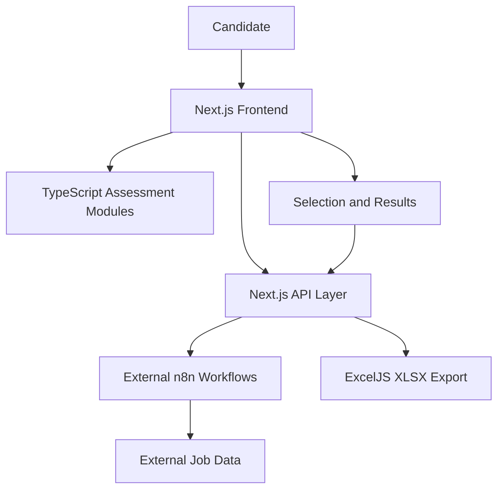

# LUNA Job Match — System Architecture

## 1. Overview

LUNA Job Match is an experimental web
application for resume analysis, job discovery,
professional diagnostics, and opportunity
selection.

The system combines:

- A Next.js and React user interface
- Next.js server-side API endpoints
- External automation workflows
- TypeScript-based assessment modules
- Excel export functionality

The current system has been validated
primarily in a local development environment.

## 2. High-Level Architecture

This diagram is a conceptual overview.
Individual route contracts and external
dependencies require additional verification.

## 3. Frontend

Technology:

- Next.js 16
- React 19
- TypeScript
- Tailwind CSS

Primary application area:

`src/app/analisar/`

Key responsibilities:

- Resume submission
- Professional profile review
- Job-search preferences
- Displaying real job-search results
- Showing experimental diagnostics
- Selecting opportunities
- Requesting Excel exports

## 4. API Layer

The application includes these API endpoints:

| Endpoint | Method |
|---|---|
| /api/analisar-curriculo | POST |
| /api/buscar-vagas | POST |
| /api/buscar-vagas-v2 | POST |
| /api/curriculo | POST |
| /api/exportar-vagas | POST |
| /api/health | GET |
| /api/simular-vagas | POST |
| /api/testar-n8n | POST |
| /api/testar-pdf-n8n | POST |

Some endpoints include development-environment
restrictions.

Request and response contracts have not yet
been fully documented.

## 5. External Integrations

The application references n8n-related
configuration for:

- Standard job-search workflow
- Experimental job-search workflow
- Service health checks
- Upload-related authentication

External integrations require their own
configuration and availability.

Real job-search data depends on the connected
external workflow and its sources.

## 6. Assessment Modules

The application contains separate TypeScript
modules for:

- Job-title relevance
- Professional competency comparison
- Seniority analysis
- Geographic indicators
- Opportunity classification
- Priority calculation
- Experimental eligibility diagnostics
- Experimental opportunity assessments

### Experimental Versions

V1: Standard classification.

V2: Competency-oriented experimental
classification and ordering.

V3: Expanded professional diagnostics.

V4: Resume-based seniority indicators.

V5: Experimental eligibility diagnostics.

V6: Experimental opportunity assessment.

The later diagnostic layers are designed
to explain findings without automatically
changing the established job-ranking behavior.

## 7. Explainability and Safety

Assessments distinguish between:

- Identified indicators
- Missing information
- Conditions requiring verification
- Relevant warnings

A match does not establish eligibility.

Scores do not represent hiring probability.

The application must not be treated as an
automated hiring decision system.

## 8. Excel Export

The application uses ExcelJS to create
XLSX output for selected opportunities.

The export is exposed through:

`/api/exportar-vagas`

The existing workflow includes job selection
before export.

## 9. Testing and Quality

Current development checks include:

- TypeScript validation
- ESLint
- Module-level regression tests
- Git-based functional checkpoints

The latest reported regression audit passed
49 out of 49 TypeScript test files.

This is not equivalent to 49 individual
test assertions.

Automated test execution and integration
testing need further standardization.

## 10. Current Constraints

- Primarily validated in local development
- External n8n configuration required
- Some endpoints restricted to development
- Production deployment not completed
- Multi-user authentication not implemented
- Production privacy review pending
- External service reliability not guaranteed
- Automated integration coverage incomplete

## 11. Future Architecture Work

- Document API request and response contracts
- Standardize environment setup
- Improve automated test reproducibility
- Review error handling and observability
- Establish authentication and access controls
- Review personal data handling
- Design secure production deployment
- Evaluate multi-user architecture

## 12. Project Status

Active development.

This document describes the architecture
currently identified through source audits
and local functional testing. It is not
a production certification.
